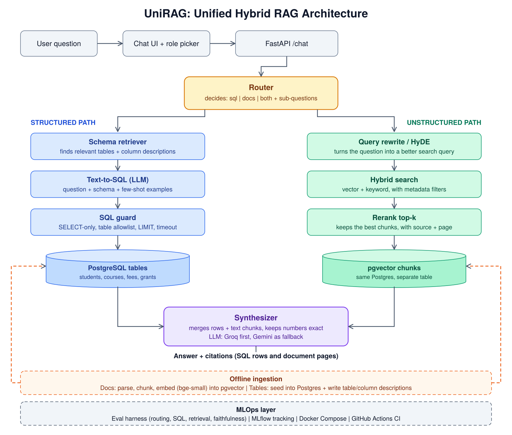

# UniRAG: Unified Hybrid RAG for Structured and Unstructured Campus Data

> Ask one question. Get one answer that uses both your **database tables** and your **policy documents**.

**Status:** In design. The data and documents are ready (see `data/`). The code is not built yet. This README is the project plan and the contract for what we are building.

---

## 1. The problem

In a university, information lives in two places:

| Type | Examples | Where it lives |
|---|---|---|
| Structured | fee ledger, GPA, course enrollment, timetable, grant deadlines | SQL tables |
| Unstructured | student handbook, grant rules, exam policies, research papers | PDFs / Markdown |

A normal RAG system only searches documents. So it fails on questions like:

> "I am a third-year IT student with a 3.8 GPA. Which research grants am I eligible for, and what is the deadline?"

To answer this, the system must:
1. Look up the student's **year, branch and GPA** (SQL).
2. Find the **grant eligibility rules** (documents).
3. Compare the two, then give the **deadline** (SQL or document).
4. Write one clear answer, with no wrong numbers.

UniRAG does this.

This project is built for the "Unified Hybrid RAG for Structured and Unstructured Enterprise Intelligence" problem statement. It uses **synthetic data only**, for a fictional university (the Aravali Institute of Technology). No real student data is used. See [data/README.md](data/README.md).

---

## 2. What the system does

- **Knows who is asking.** The UI has a role picker: choose a demo student, or **Guest / Applicant**. A guest can only reach documents (admissions, fees, general rules), never personal tables.
- **Routes** each question to the right source: `sql`, `docs`, or `both`.
- **Text-to-SQL** for questions about numbers, dates and records, with strict safety checks.
- **Hybrid search** (vector + keyword + metadata filters) for questions about policies.
- **Joint queries**: splits a question into a SQL part and a document part, runs both, and combines them.
- **Synthesizes** one answer that keeps numbers and dates exact, and **cites** its sources (SQL rows and document pages).
- **Measures itself** with an evaluation set, so every change is tested and tracked.

---

## 3. Architecture



*(Editable source: [docs/architecture.svg](docs/architecture.svg))*

### Request flow

1. User sends a question to the **FastAPI** `/chat` endpoint (from the Streamlit UI).
2. **Router** returns a structured decision: `{route: sql | docs | both, sql_question, docs_question}`.
3. **Structured path:** retrieve relevant table schemas, generate SQL, pass it through the **SQL guard**, run it on Postgres.
4. **Unstructured path:** rewrite the query (HyDE), run hybrid search on pgvector, rerank, keep top-k chunks.
5. **Both:** run both paths. If one depends on the other (for example, the student's GPA is needed before checking grant rules), run SQL first and pass the result into the document query.
6. **Synthesizer** gets the SQL rows and the text chunks, then writes the final answer with citations.
7. Every step is logged with timing, tokens and route, so we can debug and evaluate.

---

## 4. Tech stack

| Layer | Choice | Why |
|---|---|---|
| Language | Python 3.11 | standard for ML work |
| API | FastAPI + Pydantic | typed, fast, auto docs |
| UI | Streamlit | quickest chat UI |
| Database | PostgreSQL 16 + **pgvector** | one DB for tables and vectors, so the setup stays simple |
| Embeddings | `bge-small-en-v1.5` (local, sentence-transformers) | free, runs on CPU, no rate limits |
| LLM | **Groq** (primary), **Gemini** (fallback) via LiteLLM | fast and free-tier friendly; swap models with config |
| SQL safety | `sqlglot` + read-only DB role | parse and validate every query |
| Reranking | small cross-encoder (optional, measured in eval) | add only if eval shows a gain |
| Orchestration | plain Python modules | easy to read, test and explain. No heavy framework needed |
| Tracking | MLflow | track eval runs and compare experiments |
| Packaging | Docker + Docker Compose | one command to run everything |
| CI | GitHub Actions | lint, tests, small eval on every push |

> Free-tier limits of Groq and Gemini change often. Check current limits before relying on them.

---

## 5. Design decisions

**One Postgres, not three databases.** pgvector stores embeddings next to normal tables. No separate NoSQL or vector DB is needed. If needed later, the retriever interface lets us swap in Qdrant.

**Router is a first-class component.** We build two versions and compare them in the eval:
- Baseline: embedding similarity against example questions (semantic router).
- Main: LLM with structured output, which can also split a question into sub-questions.

**Schema mapping.** The LLM cannot write good SQL without understanding the tables. So we:
- Write a short description for every table and column.
- Embed those descriptions and retrieve only the relevant tables per question.
- Add a few example question-to-SQL pairs per table.
- For some tables (for example grant rules), also convert rows into text sentences and index them for vector search (table-to-text).

**SQL safety (non-negotiable).**
- Database user is **read-only**.
- Only `SELECT` is allowed (checked by parsing with `sqlglot`, not by string matching).
- Only allowlisted tables and views.
- Forced `LIMIT` and statement timeout.
- Student-specific queries are scoped to the asking student's ID.
- Failed SQL gets one repair attempt, then a clean "I could not answer this" message.

**Roles, not real login.** There is no password system. The UI sends a `student_id` or `guest` with each request. Student-specific questions ("my CGPA", "my fees") use that ID. Guests get document search plus public tables only (grants, calendar, placements). This keeps the project simple but still tests the same scoping logic that real auth would need. Request logs store the role and question, so we can see which questions are asked most and grow the eval set from them.

**Exact numbers.** The synthesizer receives SQL results as a table, not as prose. The prompt tells it to copy numbers and dates exactly. The eval checks this with an automatic numeric match.

**LLM provider is swappable.** All calls go through one small client. Fallback from Groq to Gemini happens on errors and rate limits.

---

## 6. Data

All data is **synthetic** and describes a fictional university. The full description is in [data/README.md](data/README.md). "Today" in the fake world is **2026-11-23**.

**Tables (9):** `students`, `courses`, `enrollments`, `fee_ledger`, `grants`, `grant_deadlines`, `academic_calendar`, `placement_drives`, `placement_offers_by_branch`. Schema with comments: `data/seed/schema.sql`.

**Documents (15):** academic regulations, examination rules, admissions, fees and refunds, hostel, library, co-curricular and extra-curricular activities, research grants handbook, scholarships, placement policy, placement highlights, campus IT, industry partnership cell, calendar guide.

**Why joint questions work:** the data is split on purpose. Grant eligibility rules live only in the handbook. Grant deadlines live only in a table. A student's CGPA, year, backlogs, attendance and fee status live only in tables. To answer "which grants can I apply for, and when do they close?", the system must use all three.

**Placement tables** cover five years (2020-21 to 2023-24 and 2025-26, no 2024-25) with branch splits, so questions like "how many IT students were placed in 2022-23?" are answered from SQL.

The documents were written in original words, following the topics that real university rule books cover. The numbers, names and rules are made up.

---

## 7. Evaluation

The project is judged on this, so we build it early, not at the end.

**Eval set:** 80 to 100 questions, each labelled with:
- the correct route (`sql`, `docs`, `both`)
- the expected answer facts (numbers, dates, names)
- the expected source (table or document)

Question types: pure SQL, pure document, joint, ambiguous, and "not answerable" (the system should say so).

| Metric | What it measures |
|---|---|
| Routing accuracy | did the router pick the right source(s)? |
| SQL execution accuracy | does the generated SQL return the right result? |
| Retrieval recall@k | did the right chunk appear in top-k? |
| Numeric exactness | are numbers and dates in the answer exactly right? |
| Faithfulness | is every claim supported by retrieved data? (LLM judge, spot-checked by hand) |
| Latency and tokens | p50 / p95 time, tokens per question |

Each eval run is logged to **MLflow** with its config (model, chunk size, top-k, router type), so we can compare versions properly.

---

## 8. MLOps layer

- **Docker Compose** runs Postgres, API, UI and MLflow with one command.
- **GitHub Actions** runs lint, unit tests, and a small eval on every push. CI fails if routing accuracy drops below a set threshold.
- **Config-driven:** model names, chunk size, top-k and thresholds live in config files, not in code.
- **Observability:** structured logs for every request (route, SQL, retrieved chunks, latency, tokens).
- **Reproducibility:** fixed seeds, pinned dependencies, versioned eval set.

---

## 9. Roadmap

- [x] **Phase 0: Setup.** Repo, Docker Compose with Postgres + pgvector, config, CI skeleton.
- [x] **Phase 1: Data.** The CSVs, `schema.sql` and documents already exist in `data/`. This phase is to load them into Postgres, check them, and fix anything that is off.
- [x] **Phase 2: Eval set v1.** 30 questions first, grow to 80+. Build the eval harness before the system.
- [ ] **Phase 3: Unstructured path.** Ingestion, chunking, embeddings, hybrid search. Measure recall@k.
- [ ] **Phase 4: Structured path.** Schema retriever, Text-to-SQL, SQL guard. Measure execution accuracy.
- [ ] **Phase 5: Router.** Baseline semantic router, then LLM router. Compare in eval.
- [ ] **Phase 6: Joint queries and synthesis.** Sub-question splitting, dependent queries, citations.
- [ ] **Phase 7: API and UI.** FastAPI endpoint and Streamlit chat.
- [ ] **Phase 8: MLOps polish.** MLflow tracking, CI eval gate, logging, README results table.
- [ ] **Stretch:** Self-RAG style answer checking, Graph RAG for linked entities, MCP connector, local Ollama fallback.

---

## 10. Repo structure (planned)

```
unirag/
├── README.md
├── docs/
│   ├── architecture.svg
│   └── architecture.png
├── data/
│   ├── README.md        # what the data is and how it was made
│   ├── seed/            # CSV tables, schema.sql, generate_tables.py
│   └── documents/       # 15 synthetic policy documents (Markdown)
├── src/unirag/
│   ├── api/             # FastAPI app
│   ├── router/          # semantic + LLM routers
│   ├── structured/      # schema retriever, text-to-sql, sql guard
│   ├── unstructured/    # ingestion, chunking, hybrid search
│   ├── synthesis/       # context builder, answer writer
│   ├── llm/             # provider client with fallback
│   └── config/
├── eval/
│   ├── questions.jsonl
│   └── run_eval.py
├── ui/                  # Streamlit app
├── tests/
├── .github/workflows/ci.yml
├── docker-compose.yml
├── .env.example
├── pyproject.toml
└── LICENSE
```

---

## 11. Quickstart (target, not working yet)

```bash
git clone https://github.com/<your-username>/unirag.git
cd unirag
cp .env.example .env          # add GROQ_API_KEY and GEMINI_API_KEY
docker compose up --build     # Postgres, API, UI, MLflow
python -m unirag.ingest       # load synthetic data and documents
python eval/run_eval.py       # run the evaluation
```

UI: `http://localhost:8501` · API docs: `http://localhost:8000/docs` · MLflow: `http://localhost:5000`

---

## 12. Results

*To be filled after Phase 8.*

| Version | Routing acc. | SQL exec acc. | Recall@5 | Numeric exact | Faithfulness | p95 latency |
|---|---|---|---|---|---|---|
| baseline | | | | | | |
| + LLM router | | | | | | |
| + rerank | | | | | | |

---

## 13. Limitations (planned to be honest about)

- Synthetic data only. Real campus data would be messier.
- Free-tier LLM rate limits cap throughput.
- Text-to-SQL accuracy depends on schema size; very large schemas would need more work.
- Not a production system: no real login (only a role picker) and no isolation beyond student-ID scoping.
- The placement tables are random variations of the shape of real reports. They are not real statistics.

---

## 14. License

MIT
